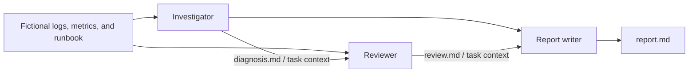

# CrewAI incident collaboration

A small, runnable example of three AI agents working together to investigate a
fictional checkout-service incident. Learn **agents, tasks, crews, and explicit
context handoffs** without connecting to production systems or a search service.



## Quick start

Requires Python 3.11–3.13, [uv](https://docs.astral.sh/uv/getting-started/installation/),
and an OpenAI API key with access to your selected model. Tested locally on Python
3.12; GitHub Actions checks Python 3.11 and 3.12.

```bash
git clone https://github.com/marcelodevops/crewai-incident-collaboration.git
cd crewai-incident-collaboration
uv sync --locked --python 3.12
cp .env.example .env
# Edit .env locally and set OPENAI_API_KEY. Never commit the key.
uv run incident-crew
```

If your key is already defined in `~/.env`, export it into the current shell:

```bash
set -a
source ~/.env
set +a
uv run incident-crew
```

The default model is `openai/gpt-4o-mini`. Set `MODEL` to another OpenAI model
available to your account. Other providers require adapting the CLI's credential
check and provider dependencies. A live run makes paid API calls; costs and
outputs vary. No search API key or CrewAI cloud account is required.

```bash
uv run incident-crew --output-dir output/my-run --quiet
```

Each run writes three files (existing files in that directory are overwritten):

| File | Agent's responsibility |
| --- | --- |
| `diagnosis.md` | Correlate evidence, calculate connection budget, state hypotheses |
| `review.md` | Challenge the diagnosis and propose mitigation and validation |
| `report.md` | Combine both perspectives, retaining uncertainty and open questions |

Use a different output directory to preserve each run. A failed run may leave
partial outputs; the final success message appears only after all tasks finish.

## What makes this collaboration?

Each agent has its own role, goal, and backstory. `Process.sequential` determines
execution order. `Task.context` explicitly passes the investigator's output to
the reviewer, and both earlier outputs to the writer:

```python
review = Task(..., agent=reviewer, context=[diagnosis])
report = Task(..., agent=writer, context=[diagnosis, review])
```

These are excerpts; see [the runnable implementation](src/incident_crew/crew.py).
The reviewer also gets the original evidence so it can check the diagnosis
independently. The Markdown files expose intermediate work for human inspection;
Task callbacks save each output with Python pathlib. CrewAI passes task outputs
in memory rather than rereading those files.

This example demonstrates sequential collaboration through shared artifacts.
It does not demonstrate autonomous delegation, parallel agents, a manager crew,
or a reviewer-to-investigator revision loop. Delegation and memory are disabled
to keep the handoffs easy to understand. Agents share a model but have separate
instructions. No tools execute commands or change infrastructure.

## Explore the incident

Read [the fictional evidence](src/incident_crew/data/incident.md) first. A release
increases the per-replica connection pool. Compare four replicas' potential demand
with the database connection budget. The agents should distinguish a likely
cause from confirmed proof, and proposed recovery from observed recovery.

Try changing the pool size, removing a log line, or making the metrics contradict
the deployment hypothesis, then rerun into a new directory. Compare the diagnosis
and review: do they notice uncertainty or merely repeat the same assumption?
Model-generated reports still require human review; the reviewer is not a formal
correctness guarantee.

## Repository guide

```text
src/incident_crew/
  crew.py             # Agents, task prompts, and explicit context dependencies
  main.py             # CLI, environment loading, and model setup
  data/incident.md    # Packaged fictional evidence
tests/test_crew.py   # Real CrewAI orchestration with a deterministic test LLM
examples/            # Clearly labeled hand-written illustrative report
.github/workflows/  # Key-free lint and test checks
```

## Development and verification

```bash
uv sync --locked --python 3.12
uv run pytest -q
uv run ruff check .
uv run ruff format --check .
uv build
```

Tests exercise the real CrewAI sequential process using a scripted `BaseLLM`.
They verify context reaches downstream agents, all three outputs are saved, and
the CLI handles missing credentials. They make no model API calls and do not
assess the quality of live model reasoning. A live run is a separate manual
check and is not part of CI. Telemetry is disabled by default in the CLI.

## Framework references

- [CrewAI crews](https://docs.crewai.com/en/concepts/crews)
- [CrewAI tasks and context](https://docs.crewai.com/en/concepts/tasks)
- [CrewAI sequential processes](https://docs.crewai.com/en/concepts/processes)

MIT licensed. This is an educational example, not an incident automation service.

## Worked report and troubleshooting

See the [illustrative report](examples/report.md) for the expected output shape
and [verification record](docs/verification.md) for what was actually tested.
The worked report is hand-written, not a claimed live-model result.

If OpenAI returns `429` with `credit_balance_exhausted` or `insufficient_quota`,
check the API account's credit balance and billing before rerunning. The local
live attempt encountered this response; automated tests still run without a key.
CrewAI currently emits internal deprecation and checkpoint-callback warnings;
this example does not use checkpoint restore.
